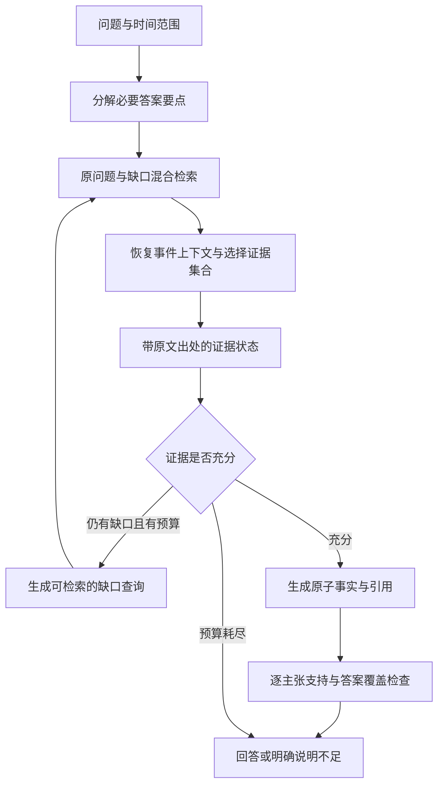

# ASA 架构、模型与后训练优化研究备忘录

日期：2026-09-07。依据：用户上传的 `PROJECT_ARCHITECTURE_METHODS_RESULTS_20260907.md`，以及下文链接的一手论文、官方模型卡和工具文档。资源假设：单张 A100 40GB、小规模训练数据、作品集项目。

**核心建议：先用受控实验拆开阅读能力、训练退化和检索缺口，再做“保留事件上下文的检索 + 可学习的证据缺口控制 + 抗干扰的证据问答训练”。第一轮不扩大端到端 RLVR。**

本文是设计与实验建议，没有访问 ASA 源码、运行模型或复核原始实验产物。所有新增参数、样本规模与晋级阈值都是实验起点，不是已验证的最优配置或效果承诺。

> 源码复核补记（2026-09-07）：后续检查确认，在本文所依据总结的基准提交
> `aa2545f` 以及 strict9 完成提交 `c692f28` 中，三个推荐
> GPU/CPU/API runtime 配置的 MiniRAG、章节隔离和自动二次检索均为开启；
> evidence-id 两个旁路配置仅 `enable_minirag=false`，其余图检索开关仍保留。
> 因此下文关于“重新默认开启”的措辞是基于上传总结的错误前提。当前同样没有
> 独立正确率 A/B 支持改成默认关闭，P0 reader 诊断期间应冻结 `c692f28`
> 既有配置，不改变任一方向的生产默认。

> Reader P0 补记（2026-09-07）：随后已用人工复核的 strict9 构造
> 9 个问题族 × 3 个 evidence condition，并在同一 Qwen3.5-4B 基座上公平
> 对照 untouched base 与当前 clean-SFT。人工修正后，base/clean-SFT 在
> 最小充分证据上均为 4/9，加入真实 hard distractor 后分别为 0/9 与 1/9，
> 实际 prompt 分别为 2/9 与 1/9。该结果证明 clean-SFT 的格式改善没有在
> 这 9 题上传导成语义改善，并暴露出明显的抗干扰、主体/关系绑定和
> over-retrieve 问题；它仍只是流程 smoke，不是系统正确率或正式约 60 题
> P0。Qwen3.5-9B 因资产缺失未运行。结论与 provenance 见
> `docs/STRICT9_READER_EVIDENCE_FINDINGS_20260907.md`。
>
> 自然语言协议对照补记（2026-09-07）：同一 strict9 minimal evidence
> 去掉 Exx schema/action/E-ID 后，base 为 3/9 complete，clean-SFT 为
> 5/9；对应 Exx 均为 4/9。只有杰克逊题被两个 reader 明确救回，女妖、
> 芙蕾达、莫斯提马与老天师的主体/关系错误仍存在。因此协议负担是局部瓶颈，
> 当前主优先级仍是 reader hard negatives 与配对证据状态 SFT。详见
> `docs/STRICT9_READER_NATURAL_LANGUAGE_CONTROL_20260907.md`。

**1．如何解读现有证据**

上传文档顶部明确标记：它由另一并发模型生成，尚未逐项源码复核；strict9 snapshot、metrics、selection ablation 已在 2026-09-07 09:44 完成。正文第 23、26.5、29、31、33 节的“尚未完成”描述不能继续沿用。最新应以 `docs/STRICT9_RETRIEVAL_SMOKE_FINDINGS_20260907.md`、`docs/ANSWER_QUALITY_IMPROVEMENT_PLAN_20260907.md` 为准，但这两份文件未附在本次材料里。

下面数字只能视为上传文档报告的历史结果。

| 历史观察 | 可以支持的判断 | 不能据此断言 |
| --- | --- | --- |
| relevance-aware 在固定完整证据、未重合那组题上为 13/44 = 29.5% complete | 证据到位后，模型、提示或输出流程仍有严重瓶颈 | 全系统当前成功率就是 29.5%；4B 的能力上限就是 29.5% |
| answer 子集为 31/68；全部旧集合为 31/79 | 分母和是否回答显著影响结果 | 45.6% 是无泄漏的端到端准确率 |
| 8 题端到端有 1 题明确正确、1 题部分正确 | 足以发现真实失败样式 | 可精确估计真实用户成功率 |
| 第 2→3 轮 top-5 Jaccard 为 0.936；35/35 hypothesis question 相同 | 后续检索高度重复，应研究信息缺口驱动的查询 | 加一轮一定能提高正确率 |
| 288/1929 facts 被校准为 unsupported；125 个“负例候选”实际支持 claim | 正例污染和漏标正例都存在 | exact gold ID 是唯一真值 |
| 训练重点为 Exx，默认 GPU 仍用 quote；API/CPU 默认 weak | 存在需要立即核对的训练与部署契约差异 | 已证明当前使用的具体 adapter 一定与 quote 不兼容 |
| chain rerank 使用 1536 token，prompt 默认取 10 条 | 应测链截断、互补证据丢失和顺序影响 | 换 top-16 或长上下文必然有效 |

文档把集合覆盖列为第一瓶颈；我的补充判断是：**完整证据下的低 complete 足以要求同时启动 reader/adapter 诊断，不能只等检索侧优化。** 也不要把不同集合上的 Recall 与 29.5% 相乘来推算端到端正确率。

**2．最先做的对照：用较少推理区分三个病因**

先从训练未覆盖的问题族中整理约 60 个开发问题，人工审定必要答案要点、合法替代证据、证据是否足够；覆盖事实、身份、因果、跨章关系、多子问。它们用于诊断和调参，不承担最终泛化结论。

固定同一批问题，交叉比较三种 reader 与三种输入：

| Reader | 人工核对的最小充分原文 | 充分原文 + 真实同场景干扰 | 当前系统实际 prompt |
| --- | --- | --- | --- |
| Qwen3.5-4B 原模型，无 ASA adapter | 基础读证据能力 | 抗干扰能力 | 原模型端到端阅读表现 |
| 当前 4B + clean-SFT adapter | 微调后的能力变化 | 微调是否抗干扰 | 当前模型表现 |
| Qwen3.5-9B 原模型 | 更强 reader 参考 | 更强 reader 的噪声容忍 | 单纯增加容量能救多少题 |

每格保持问题、答案评分标准、证据预算、量化策略可比；先采用统一 Exx 接口。记录原始输出、解析后的输出、grounding 后的动作。自然语言最小答案作为额外的协议诊断，仅在部分失败题上做，不把它与 Exx 结果直接混成模型排名。

| 对照结果 | 下一步 |
| --- | --- |
| 原 4B 显著好于 adapter | 优先查标签、chat template、loss mask、过拟合与旧字段污染，重建 SFT |
| 自然语言答案正确，Exx 或 grounding 后失败 | 优先查协议负担、事实切分、引用约束、截断和校验误杀 |
| 三个 reader 在实际 prompt 都差，在充分原文下明显改善 | 优先改语料表示、检索和 evidence packing |
| 4B 在充分原文下仍差，9B 明显改善 | 9B 作为 reader 候选；4B 保留给缺口控制或蒸馏 |
| 最小充分原文好，加入干扰后明显下降 | 优先 RAFT 风格抗干扰训练及证据选择 |
| 人工审定后的充分原文仍使所有模型失效 | 复核问题歧义、说话人可信度、时间限定与答案 rubric；再考虑更强离线 teacher |

所谓“oracle evidence”是诊断参考，不是数学上必然高于所有实际检索输入的上界。不同措辞、上下文和噪声会改变模型表现。

协议检查至少保留这些字段：checkpoint/adapter SHA、tokenizer、实际 chat template、thinking 开关、量化、完整渲染 prompt、截断位置、finish reason、raw action、validated action、校验拒绝原因。Qwen3.5 官方支持 thinking/non-thinking；必须与训练模板一致。对短 Exx 输出先验证 non-thinking 路径，再单独测试有预算的 thinking 路径，避免把模板变化误认成模型能力变化。[Qwen3.5-4B 官方说明](https://huggingface.co/Qwen/Qwen3.5-4B)

**3．推荐架构：让各层共享“已经证实什么、还缺什么”**



这是逻辑职责划分，不要求同时常驻多个大模型。第一版可共用一个 4B，通过不同任务提示或 adapter 分阶段执行；只有 reader 对照确有收益时才引入 9B。

**3.1 语料表示：小切片定位，事件上下文供阅读**

现有 420 字切片、一个 segment overlap、metadata 增强已经有价值；还需检查读者最终看到的原文是否保留了对话对象、前后指代、否定和时间变化。片段中出现“他”“那件事”“她的计划”，即使语义相似，也可能不足以确定事实主体。

建议分三种对象管理，先在少量错误集中出现的剧情范围试点：

| 对象 | 内容 | 用途与限制 |
| --- | --- | --- |
| 原文 child chunk | 保留现有可追踪的短片段、说话人与 source offsets | 精确召回和引用 |
| parent scene/window | 相邻对话或一个语义场景，初试约 800–1600 中文字的窗口 | 命中 child 后恢复指代与关系上下文；按 token 预算展示 |
| 事件卡 | 主体、行动、对象、时间、结果、动机证据、对应原文位置 | 补充检索入口和 memory；未经原文核对的摘要不作为事实来源 |

为 search_text 补充短的、来源可追踪的上下文前缀：所在事件、参与者、说话人和已确定的指代。不要把不确定的角色身份硬补成事实。Contextual Retrieval 的相关思路是在 chunk 前加入解释其位置的上下文，并用于 dense/BM25；ASA 已有 metadata，应测试新增的语义上下文贡献。[Anthropic 原始方法](https://www.anthropic.com/engineering/contextual-retrieval)

剧情领域还需要区分“角色声称”“角色猜测”“旁白确认”“后续揭示”。同一角色在不同章节的身份状态不能无条件合并；故事叙述顺序也不等于世界内事件时间。实体共现、先后发生与因果关系应有不同边类型，缺乏因果原文就标 unknown。

第一版的事件卡可以存在 JSONL + 现有索引中，不需要先建设全量知识图谱。若后续要做 memory 展示，可在选定故事上建立有出处的事件关系图，再与无图版本做 A/B。HippoRAG 2 可以作为图记忆架构参照，但其收益不能直接外推到中文剧情，也不能证明现有 MiniRAG 应改变既有默认状态。[HippoRAG 2](https://arxiv.org/abs/2502.14802)

**3.2 集合选择：直接面向问题要点，保留互补证据**

当前 query-token coverage 主要覆盖词，不保证覆盖因果链。对“某事件是什么、为什么发生、造成什么结果”，可先建立需要回答的要点，但未知内容必须保持未知。

示意状态，不是《明日方舟》的实际剧情事实：

```json
{
  "required_slots": [
    {"id": "event", "need": "发生了什么", "status": "supported", "source_spans": ["doc17:120-260"]},
    {"id": "motive", "need": "采取行动的原因", "status": "missing", "source_spans": []},
    {"id": "outcome", "need": "直接结果", "status": "supported", "source_spans": ["doc42:30-150"]}
  ],
  "next_query": "已确认主体 已确认事件 动机 原因"
}
```

这里的 slots 在运行时只能来自用户问题和已见原文，不能使用 gold answer/required_evidence 等隐藏字段。每条 evidence memory 同时保存原文跨度、主体、时间、支持状态和来源；生成的中间摘要不能因被写入 memory 就变成真值。跨轮使用稳定 doc/span ID，渲染时才重新映射为 prompt-local E-ID。

选择器从“单文档分数高”改为“对当前未覆盖要点有多少新增支持”。可从 query-slot relevance + 原文支持检查的简单版本开始；再训练条件打分器，输入 `(question, current evidence, missing slot, candidate)`。同一 chunk 在不同已选集合下的价值可以不同。

不要先把链分数摊回各成员，再让最终 top-k 任意拆散链。把 2–3 个互补片段作为 bundle 进入 packing，并按总 token 预算与单片段一起比较。只用单文档贪心可能漏掉“各自不足、组合才充分”的两跳证据，因此需要保留少量候选 bundle 或有限宽度搜索。

优先做相同 token 预算下的 top-score、MMR、slot coverage、bundle packing；top-10 与 top-16 只是补充控制。用 child 定位、parent 供读后，chunk 数已不能代表实际上下文成本。

**3.3 控制器：训练缺口判断，比重复生成完整 conclusion 更聚焦**

最贴近的已有工作是 2026 年 S2G-RAG：它训练独立的小型 judge 输出充分性与结构化缺口，使用 2,804 条中间状态监督。ASA 可借鉴其轨迹蒸馏方式，但应按问题/事件隔离数据，保留预算耗尽后弃答的产品规则，并为句子抽取保留必要上下文。[S2G-RAG 原文及附录](https://arxiv.org/html/2604.23783v1)

运行时的后续查询要求：使用已有证据确定的 bridge entity，针对一个具体未知关系检索；原问题保留为锚点。独立子问题可以一次生成少量查询并批量执行，有依赖的第二跳则等待第一跳结果。

novel-doc rate 只作诊断或轻量 tie-break。全新但无关的文档没有价值；已见故事里的另一句话可能正是所需证据。因此不应硬屏蔽 seen source，也不应主要奖励“检索结果新”。只有没有可执行的新查询、没有支持增益且剩余预算不值得继续时才停止。阈值必须在开发集上校准。

控制器错误要拆成两类：充分时误判不足会增加检索或弃答；不足时误判充分会引发抢答。除了分类 F1，还需看这两类错误在完整系统里的代价。

**3.4 验证器：三种任务分别学习、分别验证**

| 任务 | 正确输入 | 需要回答的问题 |
| --- | --- | --- |
| 文档 relevance reranker | question + document | 对用户的信息需求是否有帮助？ |
| claim support verifier | claim + 自己引用的证据集合 | 这些证据是否共同支持该主张？ |
| answer completeness checker | question + 必要答案要点 + answer facts + 可见证据 | 是否回答了全部必要部分，且没有关键错误？ |

claim verifier 的 100% clean pair accuracy 不能当 retrieval reranker 证据。某段材料不支持一个 claim，却可能支持同一问题的另一个必要要点，因此现有 1005 个 claim-negative 也不能原样拿去训练 question-document reranker。

对真正需要多段联合支持的主张，不能要求任一单段独立蕴含完整结论，也不能简单用 max(pair score) 代替联合验证。先将复合事实拆开；确需多跳时检查引用集合与中间连接。

Exx 当前每 fact 只许 1–2 个 E-ID，而 strict9 文档中存在 3–4 段 gold chain。这不自动意味着协议错误，但应审计是否有合法结论被引用上限限制。通常优先拆原子事实；确需联合三段的结论，再评估受控调整引用上限。

词法 grounding 的拒绝应与语义人工标签对照，量化“正确改写被误杀”和“主语/否定错误被放过”。可以让规则处理引用存在性，让独立语义模型处理支持关系；先旁路记录，不直接把尚未验证的 verifier 设为生产硬门。

SURE-RAG（2026）提供 Supported/Refuted/Insufficient 的集合验证参照，但它在受控充分性数据与自然幻觉数据上的表现存在明显差异，且没有解决完整的跨段联合推理。适合借鉴标签与校准，不能当即插即用的最终裁判。[SURE-RAG v2](https://arxiv.org/html/2605.03534v2)

**4．具体模型选择**

| 角色 | 第一轮候选 | 选择逻辑 |
| --- | --- | --- |
| Reader 对照 | Qwen3.5-4B 原模型、现有 adapter、Qwen3.5-9B 原模型 | 先确定 adapter 与容量贡献，再决定训练哪个 |
| 缺口控制 | 先复用 Qwen3.5-4B，单独任务或 LoRA | 不增加新常驻模型就能验证角色拆分 |
| Dense | 原 bge-small-zh-v1.5 对照 Qwen3-Embedding-0.6B | 项目已做过 Qwen 旁路，优先规范化对照，无需立刻再扩模型池 |
| Relevance reranker | 当前 BGE relevance checkpoint 对照 Qwen3-Reranker-0.6B | 固定同一候选池，测充分证据保留与端到端传导 |
| Binding verifier | 已有 augmented v2 先保留离线使用 | 复用资产，但补充真实多跳/主体/时间难例 |

Qwen3-Embedding-0.6B 官方模型卡给出 query instruction、last-token pooling 与归一化用法。核对当前实现是否正确使用查询指令、padding/pooling、索引版本及完整重建；不要使用通用 mean pooling 的假定。Qwen3-Reranker-0.6B 要按其 query/document 格式与 yes/no 分数使用，不能仅替换 checkpoint 路径。[Embedding 模型卡](https://huggingface.co/Qwen/Qwen3-Embedding-0.6B)、[Reranker 模型卡](https://huggingface.co/Qwen/Qwen3-Reranker-0.6B)

9B 作为下一档有利于保持同模型族比较，但没有证据表明它在 ASA 一定胜出。约 9B 参数按 2 bytes/参数粗算，权重约 18GB；这是量级估算，不是训练或服务峰值，实际还包括未量化模块、缓存、激活、优化器、工作区等。[Qwen3.5-9B 官方模型](https://huggingface.co/Qwen/Qwen3.5-9B)

单卡部署先用单请求、受限上下文顺序执行各阶段；训练时卸载推理服务与 reranker。缓存候选和 teacher 标签。不要由“权重能放下”推断“长上下文 DPO/GRPO 与检索器同时运行也能放下”。CPU/API 的 reranker 与 grounding 默认不同；比较 reader 时应固定本地检索与验证流程，仅替换生成器。

**5．训练数据：让同一个问题在不同证据状态下产生不同动作**

现有 clean-SFT 已经改善格式，因此下一轮 SFT 要增加真实的阅读、缺口和抗干扰监督。RAFT 的可借鉴点是在相关证据中混入 distractors，并监督基于正确证据作答；ASA 需要额外加入证据不足时的动作训练，这属于本项目适配，不是 RAFT 原方案的同义复述。[RAFT](https://arxiv.org/abs/2403.10131)

先从约 400 个独立、可追溯的训练问题/事件出发，每个构造下列五种状态，形成约 2,000 条基础状态样本。若现有干净独立问题不足，可先以 100–200 个起步。扩增样本不等于增加独立问题数量。

| 状态 | 构造 | 目标行为 |
| --- | --- | --- |
| Full | 有最小充分证据 | 完整、简短、逐事实支持地回答 |
| Full + hard distractors | 充分证据 + 同角色、同场景但主体/时间/关系不同的真实片段 | 保留完整答案，忽略诱导信息 |
| One-edge-missing | 移除某必要链环的所有等价支持，但保持长度和文档数近似 | 指出实际缺口；有检索预算则生成查询 |
| Decoy-full | 表面关键词、角色齐全，但证据不支持所问关系 | 不抢答；定位关系或消歧缺口 |
| None / conflicting | 无相关证据，或证据真实冲突 | 区分当前没找到、语料不可答、冲突待消解；根据预算选动作 |

删除一条 gold chunk 之后要重审充分性：如果剩余片段提供替代证明，仍应标为 Full。不能把“少了指定 ID”直接标成不足。None 也不自动意味着 abstain——只要还有语料检索机会，应允许 retrieve_more。

Full 与缺失状态应尽量匹配长度、条数和格式，避免模型学到“短 prompt=弃答”。实体替换仅用于明确标记的局部证据反事实测试；训练优先使用真实同场景难例，并检查替换后的类型、语法、时间与共指一致性。反事实文本不进入正式剧情索引。

随后运行当前 student 在训练问题上的真实检索，采集中间 `(question, visible evidence, remaining budget)`；由 teacher 只看同样的可见证据标注缺口与动作。根据真实失败补充或替换约 1,000–2,000 条样本，形成约 2,000–4,000 条首轮精选训练集。这比只从完美 gold prompt 合成所有过程数据更贴近运行分布。

teacher 可以用训练集 gold 做离线验收，但生成可学习的缺口时不能偷看被移除的那段答案；否则 student 会学到部署时无法产生的 oracle 查询。下一条查询不得直接粘贴隐藏 gold span。

所有同问题改写、同事件模板、同一个问题的不同轮次、证据删除与替换变体必须进入同一 split。先划分原始事件/问题族，再生成变体。若要宣称跨故事泛化，另设 story-held-out 测试；已知语料的正常索引不等于监督标签泄漏，需区别二者。

**5.1 SFT 的输出和损失**

只监督可核查的紧凑状态：缺口类型、目标实体、待查关系、原子事实、引用 ID、动作。长篇自由 CoT 会增加标注噪声和 token 成本，当前不作为第一训练目标。输出事实数由必要答案要点决定，不把“1–3 条”设成让多子问必然漏答的硬限制。

训练/runtime 必须共享 canonical renderer，同时检查 tokenizer/chat template、EOS、assistant 起始前缀与 thinking 标记。使用 assistant/completion loss mask，避免长证据正文主导目标。抽查一批实际 tokenize 后的样本，核对非忽略 label 究竟落在哪些 token；JSON 正确并不保证 mask 正确。TRL 的 assistant-only loss 依赖 chat template 对生成区间的支持，应验证具体版本。[TRL SFT 文档](https://huggingface.co/docs/trl/sft_trainer)

证据顺序随机化并同步重映射 E-ID；在不同 epoch 保留相同来源的绑定；加入长短上下文混合。不要把一批数据全部按 E1/E2 放答案证据，否则容易学习位置捷径。packing 前检查跨样本注意力和边界支持，第一版可以关闭以降低配置变量。

**5.2 Query 训练：先离线选优，再尝试偏好优化**

对同一个真实中间状态生成 3–4 个候选查询，实际在冻结语料索引上执行。根据它们是否补上缺口、提升最终完整回答、增加多少检索成本进行离线排序。只保留差异明确的样本：无收益的平局不强造偏好。

先把最有效查询做 rejection-sampling SFT；有约 500–1,000 个高质量配对后，再比较小步 DPO。配对的 chosen/rejected 必须面对同一 question、同一可见证据和同一预算，不能把 Full 的回答与 Missing 的弃答配成一个 DPO 样本。DPO 可避免在线 RL 的完整 rollout 更新流程，但仍依赖可信偏好。[DPO 原论文](https://arxiv.org/abs/2305.18290)

可以构造的偏好对包括：正确缺口查询优于重复原问题；完整且受支持的答案优于漏答；语义正确但引用错位的答案不应优于引用完整的答案。匹配两侧长度和格式，防止偏好优化只学短答案、更多引用或一律弃答。保留 clean-SFT 对照，按完整回答与过度弃答选 checkpoint。

现有 KTO 数据若只有可信二元标签，可以继续保留为对照。推荐先做 DPO 的原因是这些任务能构成同状态的直接比较，并不是断言 DPO 普遍优于 KTO。

**5.3 Reranker 与 embedding 的训练时机**

先根据阶段 snapshot 判断是否真的有 candidate miss/rerank drop。若 gold 支持大多已在候选池，只训练 embedding 未必值得；若候选池就缺失，先处理指代/事件表示和查询，再决定 dense 微调。

relevance reranker 的正例应覆盖所有有用要点与桥接片段；hard negatives 按问题层面重标。embedding 微调采用多正例思路，把同事件不同有效表达、合法替代支持列入正例集合或 mask；避免把同批次中同一事实的另一证据当 in-batch negative。

需要训练互补性时，新增 `(q, selected evidence, missing slot, candidate)` 条件任务，比较补齐证据与重复同一事实的候选。RankRAG 为“排序与回答联合训练”提供了相关依据，但 ASA 应先验证独立任务，避免所有目标一次混入同一个低数据训练配方。[RankRAG](https://arxiv.org/abs/2407.02485)

**5.4 RLVR 放到后面，奖励针对可验证行为**

Search-R1 说明可以通过检索交互学习查询与推理，并在训练中屏蔽检索返回 token 的策略损失；它没有证明 ASA 的开放式剧情答案已经具备可靠的可验证奖励。[Search-R1](https://arxiv.org/abs/2503.09516)

如果开展 pilot，先冻结 retriever、reader 与语料，只优化小型查询控制器；复用已缓存的检索候选、参考分数和离线裁判，减少 A100 上的同时常驻模型。

建议采用分层目标：格式和 ID 合法只作为门槛；主要收益来自人工/独立验收的必要要点覆盖与受支持的完整答案；关键矛盾、无支持断言、重复无效检索扣分；token/检索次数成本的权重要小于任务质量。

对证据不足状态，不应奖励盲目回答，也不应把所有弃答都设成高奖励。奖励应依赖当前证据与剩余预算。冻结裁判后仍要用独立人工或不同裁判验收，不能让同一 verifier 同时产标签、训练奖励和最终裁判。

如果奖励主体是 GLM/learned verifier 对开放式语义的评分，准确叫法是带模型裁判的 RAG 偏好/RL；只有可确切判定的部分才是 verifiable signal。不要把它包装成数学题式完全可验证 RLVR。

**6．A100 40GB 的首轮训练配方**

以下是待测起点；真实峰值取决于序列长度、batch、LoRA 目标模块、Qwen3.5 内核、loss 实现和软件版本。

| 参数 | 4B 首选实验 | 9B 条件实验 |
| --- | --- | --- |
| 基础权重 | 优先 BF16 + LoRA；显存不足再 QLoRA | 优先 4-bit NF4 QLoRA |
| 计算 dtype | BF16 | BF16 |
| LoRA rank / alpha | 16 / 32 起步；必要时对照 32 / 64 | 同左 |
| dropout | 0.05 | 0.05 |
| 初始序列长度 | 4096，总长度必须覆盖完整目标 | 4096；验证后再试 6144/8192 |
| micro batch | 1–2 | 1 |
| effective batch | 16 左右，通过 gradient accumulation 实现 | 16 左右 |
| SFT 学习率 | 5e-5 与 1e-4 两档，先短 pilot | 同左，按开发集选 |
| epoch | 1–2，按语义指标早停 | 1–2 |
| DPO 学习率 | 5e-6 起步，beta=0.1 作为初始值 | 仅在确有收益且显存验证后做 |
| 内存措施 | gradient checkpointing；训练关闭 cache；检索预计算 | 同左；参考 log-prob 预计算 |

QLoRA 是冻结量化主模型、训练低秩 adapter；NF4、double quant 与 BF16 compute 可按官方实现配置。[QLoRA 原论文](https://arxiv.org/abs/2305.14314)、[PEFT 量化指南](https://huggingface.co/docs/peft/developer_guides/quantization)

Qwen3.5 使用混合线性/全注意力结构，不能无审计复制旧 Llama 的 `q_proj/v_proj` 列表就假定所有目标层被覆盖。枚举实际 text backbone 的线性模块，记录命中与可训练参数；纯文本项目冻结视觉模块和不需要更新的输出层。确认高效 DeltaNet 内核可用，防止退回高内存/低吞吐路径。[Transformers Qwen3.5 文档](https://huggingface.co/docs/transformers/model_doc/qwen3_5)

DPO 的参考模型若预计算 log-prob，必须固定参考 checkpoint、prompt 和分词；某些内核/数据类型组合不支持这一选项，按固定版本文档检查。先完成一次真实前向、反向、保存、重载与渲染推理的小步验证，再扩大数据；这只是显存和流程验证，不是有效性结论。[TRL DPO 文档](https://huggingface.co/docs/trl/dpo_trainer)

不承诺训练多少小时或多少 GB：本次没有 A100 实测。4B/9B LoRA 是值得优先试的规模；一次性常驻 actor、reference、rollout engine、reader 和 reranker 的长上下文 GRPO 不作为单卡第一方案。

**7．评测设计：承认多种合法证据，避免只提高弃答率**

优先冻结约 150 个独立测试问题，例如 120 个语料确实可答、30 个确实不可答/有歧义的问题；与约 60 个开发题、训练题按事件/问题族隔离。数量是起点，置信区间仍可能宽。不要在 9 题 strict smoke 上反复调参再宣称 +5pp。

主指标应为：

1. 在所有语料可答测试问题中的完整正确回答率；
2. 回答部分的受支持率与关键无支持/矛盾率；
3. 可答题的 over-abstain，以及不可答题的错误作答率；
4. 同等回答覆盖率下的错误率，或完整的 risk–coverage 曲线；
5. warm p50/p95、冷启动、检索调用次数、总 token 与各阶段耗时。

另设 Full/Missing/Decoy 配对控制集测试“当前 prompt 的充分性”，不要把它与“整个语料是否可答”混成一个标签。

retrieval 仍保存五阶段列表，但 gold 应支持“多种合法证明集合”。对一个必要要点，若证据方案 A 或 B 都成立，只需覆盖其中一个完整方案；不能要求收齐所有等价证据的并集。最稳妥的是标注必要要点及可替代支持组，评价每个要点是否存在完整支持。

如果修改 chunking，旧 doc ID 的 exact coverage 已不可直接比较，应映射回原文 source span 或原子支持单元。E-ID 只用于 prompt-local 引用审计，不承担跨索引版本真值标识。

完整答案评分要分开：要点覆盖、主张支持、主体、关系方向、时间、相关性。对照原始答案和验证后答案，从而统计 verifier false rejection。阶段“唯一首断点”方便汇总，但一道题可能同时存在召回不足与 reader 错误，应保留多标签诊断与 oracle 干预结果。

最终仅对有前景的配置做多个训练 seed 与 family-level 配对 bootstrap；每个问题族先汇总再重采样。同一 teacher 产生的答案和自动裁判一致不能当独立真值。对所有关键分歧与随机样本做人审。文档的 +5pp 可以作为研究目标，但不能跳过置信区间。

**8．建议执行顺序与停止条件**

| 优先级 | 实验 | 固定什么 | 需要看到什么 |
| --- | --- | --- | --- |
| P0 | 获取已有 strict9 新审计、冻结真实运行配置 | 模型和索引资产 | 消除过时结论，不重复已完成工作 |
| P0 | 3 reader × 3 evidence 诊断；strict9 已完成 2-reader 流程 smoke，正式约 60 题与 9B 待完成 | 同一问题、prompt 契约、评分 | 定位容量、adapter、干扰或校验损失 |
| P1 | child→parent 与来源明确的上下文前缀 | 同一 reader、相同 token 预算 | 身份/因果错误减少，候选充分支持改善 |
| P1 | slot/bundle packing 对照 top-score/MMR | 同一候选 snapshot | 充分支持进入 prompt，并传导到 complete |
| P1 | 4B 的 RAFT 风格证据状态 SFT | 固定检索与 renderer | Full 抗干扰提升，Missing 不抢答，over-abstain 受控 |
| P2 | 小型 sufficiency/gap controller + 两轮检索 | 固定 reader 和 retriever | 第 2 轮缺口填补率及完整回答率提高 |
| P2 | 基于真实检索收益的 query SFT/DPO | 同一中间状态与索引 | 查询有效性改善，不以无关 novelty 换奖励 |
| P2 | 9B reader | 已选中的最佳固定证据流程 | 完整正确与延迟的实测权衡有价值 |
| P3 | 条件 reranker / embedding 微调 | 按实际 stage drop 定位 | 相应层充分支持增加且端到端传导 |
| P3 | 小规模策略 RL、事件图扩展 | 可信评测与标签 | 相比更便宜 SFT/DPO 有稳定额外收益 |

这是依赖顺序，不是要求所有组合穷举。某项指标改善却不能传导到完整正确回答，就停在研究旁路；不要把每项优化都堆进默认架构。

如果只做三个动作：完成 reader/协议诊断；构造同题不同证据状态的干净数据；训练可输出具体缺口的控制器并测第二轮检索收益。

**9．相关工作如何选，而不是只收集方法名称**

| 方法 | 对 ASA 最有用的部分 | 优先级与边界 |
| --- | --- | --- |
| [Sufficient Context](https://arxiv.org/abs/2411.06037) | 区分上下文不足与模型未正确利用上下文 | 高；用于诊断，不保证中文剧情收益 |
| [Contextual Retrieval](https://www.anthropic.com/engineering/contextual-retrieval) | 为 chunk 恢复上下文含义 | 高；与已有 metadata 做增量消融 |
| [RAFT](https://arxiv.org/abs/2403.10131) | 在干扰证据中学习正确阅读和引用 | 高；额外补足检索/弃答状态监督 |
| [S2G-RAG](https://arxiv.org/abs/2604.23783) | 充分性、具体缺口与中间轨迹监督 | 高；最贴近现有缺口，不照搬其运行和数据切分规则 |
| [RankRAG](https://arxiv.org/abs/2407.02485) | 排序与生成目标协调 | 中；先区分 relevance、entailment 与 completeness |
| [SURE-RAG](https://arxiv.org/abs/2605.03534) | 支持/反驳/不足与选择性回答校准 | 中；跨自然数据泛化与多段推理需另测 |
| [DynaKRAG](https://arxiv.org/abs/2607.06507) | 依据证据状态选择继续检索、改写、扩展或停止 | 后续研究；先简化到已有两轮流程再学习多动作策略 |
| [Search-R1](https://arxiv.org/abs/2503.09516) | 检索交互策略训练与检索 token masking | 后续研究；预算和 reward 可靠性是前提 |
| [HippoRAG 2](https://arxiv.org/abs/2502.14802) | 有结构的长期知识检索 | 后续 memory 方向；先证明事件表示本身的收益 |

其中 2026 年条目作为最新相关研究阅读，本次不宣称已独立复现或已获得会议审稿认可。论文 benchmark 增益不用于预测 ASA 的提升幅度。

**10．适合作品集的研究命题**

建议把成果聚焦为：**在长篇中文剧情中，以带出处的事件证据状态支持小模型的缺口检索，并通过同题证据干预训练提升完整、受支持的回答。**

“有 slot ledger”“多轮 RAG”“小模型学会充分性”本身已经有相近工作，不能单独宣称原创。可验证的差异可以是：

- 角色发言、世界事实、事件时间与后续揭示的区分；
- 同问题的证据删除、替换、恢复能否引起正确的动作与答案变化；
- 不依赖唯一 gold ID 的替代证明集合评测；
- 单卡、固定 token 与检索预算下，事件状态训练是否优于普通 RAFT、静态 coverage 和重复查询。

作品集展示最好包含逐题可审计过程：原问题、已支持要点、尚缺关系、实际查询、恢复的原文跨度、最终答案与失败归因。只显示图谱规模、训练 loss 或漂亮的 action accuracy，无法证明用户问答真正改善。
