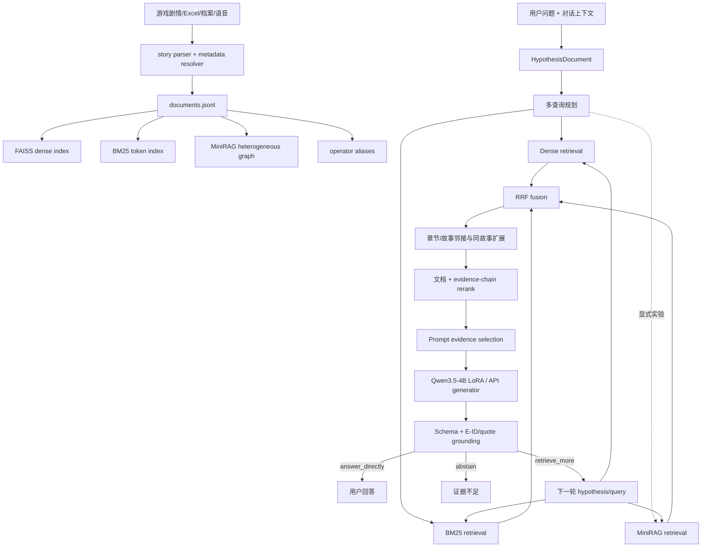
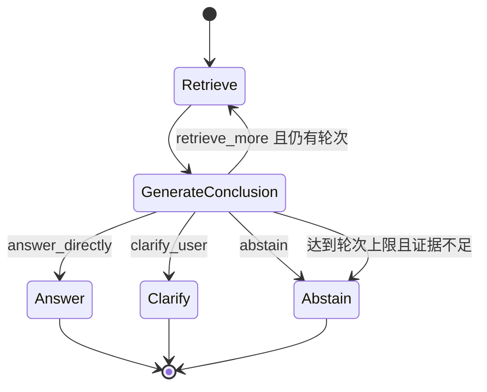

# ASA 当前项目架构、方法与结果说明

> 隔离警告（2026-09-07）：本文由另一并发模型生成，尚未完成逐项源码复核，
> 只能作为待审参考，不能作为最新实验结论。第 23、26.5、29、31、33 节仍
> 声称 strict9 snapshot/metrics/selection ablation 不存在，但这些产物已于
> 2026-09-07 09:44 完成；第 8.3、33 节关于 MiniRAG“默认关闭”的描述也与
> 本文基准提交中的三个推荐 GPU/CPU/API runtime 配置不一致。最新审计以
> `docs/STRICT9_RETRIEVAL_SMOKE_FINDINGS_20260907.md` 和
> `docs/ANSWER_QUALITY_IMPROVEMENT_PLAN_20260907.md` 为准。

日期：2026-09-07
工作区：`/home/maplerhythm/ASA/ASA-ArknightStoryAgent`
分支：`fix/grounding-pool-chain-priority`
基准提交：`aa2545f438ae9a2e7d2044a0aea017d34bf655b9`
文档性质：当前代码与既有实验产物的现状快照，不是发布承诺

## 1. 文档目的与结论边界

本文把 ASA 当前项目的以下内容放在同一个可追溯视图中：

1. 产品目标、运行模式和代码边界；
2. 语料、索引、检索、生成、grounding 和多轮控制架构；
3. Exx 数据协议、SFT/KTO/RLVR、hard-negative、verifier 和 gold 校准方法；
4. 当前评测协议、已完成结果、尚未完成的实验；
5. 当前真正限制回答正确率的瓶颈；
6. 生产默认、旁路实验和明确禁止外推的结果；
7. 后续提升回答正确率的推荐顺序。

全文采用以下证据等级：

| 标记 | 含义 |
| --- | --- |
| 已实现 | 当前代码中存在并可由入口调用 |
| 默认启用 | 当前推荐 runtime 配置会启用 |
| 旁路实验 | 已有代码或配置，但不应替换默认配置 |
| 已测 | 有保存的评测结果 |
| 待测 | 有方案或工具，但尚无有效结果 |
| 不可外推 | 数据规模、泄漏或指标口径不足以支持生产结论 |

最重要的口径是：

- `schema valid`、`action accuracy`、E-ID 合法率不是回答正确率；
- verifier agreement/AUC 不是回答正确率；
- retrieval Recall 不是回答正确率；
- fixed-evidence 评测不是完整系统正确率；
- 含训练问题族重合的 79 题结果不能当泛化准确率；
- 严格 9 题 manifest 只能作为 retrieval smoke，不能当回答正确率；
- `glm_verdict=not_run` 的 5588 个候选不是干净 hard negative。

## 2. 项目定位

ASA，即 ArknightStoryAgent，是一个面向《明日方舟》剧情问答的本地优先 RAG
系统。它试图解决的不是普通百科问答，而是以下更困难的问题：

- 从大量剧情、档案、语音中定位具体事件；
- 识别角色别名、身份和跨章节关系；
- 回答“为什么”“真实身份是什么”“某事件具体指什么”等多跳问题；
- 在证据不足时继续检索或明确弃答；
- 将回答中的每个事实绑定到模型实际可见的证据；
- 支持 GPU 本地、CPU 本地和本地检索加远程 API 三种运行方式。

当前系统的核心思想可以概括为：

> 先由生成模型把问题结构化成检索假设，再用 dense 和 BM25 形成默认候选池，
> 经 RRF、可选邻接扩展和证据链 reranker 排序后选出有限
> 证据，最后由 4B/远程模型在有限动作协议中回答、续检索或弃答，并通过
> 引用校验约束输出。MiniRAG、章节隔离和图引导二次检索保留为显式旁路实验，
> 推荐配置默认关闭。

当前系统尚未达到生产级回答正确率。现阶段最成熟的是工程链路、结构化协议和
离线审计能力；最薄弱的是“完整证据集合是否进入 prompt”和“证据到位后是否
生成完整、相关且逐事实受支持的回答”。

## 3. 三个相互独立的系统平面

ASA 实际上包含三个平面，不能混为一个模型：

### 3.1 运行平面

负责真实用户请求：

```text
用户问题
  → hypothesis 生成
  → 多查询构造
  → dense / BM25
  → RRF 融合、可选邻接扩展
  → 可选 MiniRAG/章节扩展旁路实验
  → 文档与证据链 rerank
  → prompt evidence selection
  → conclusion/action 生成
  → grounding 校验
  → 回答 / 续检索 / 弃答
```

### 3.2 数据与训练平面

负责把历史 grounding 数据转换成统一 Exx 协议，并构造 SFT、KTO、verifier
和未来 RLVR 数据：

```text
旧 grounded 数据 / teacher 标签
  → 只根据模型可见证据映射 E-ID
  → gold binding GLM 校准
  → set-level 语义复核
  → SFT / KTO 数据
  → 本地 4B 或 reranker verifier
  → 小规模 RLVR 候选
```

### 3.3 评测与审计平面

负责区分错误发生在哪一层：

```text
固定证据模型评测
  + 五阶段 retrieval snapshot
  + prompt selection ablation
  + 完整端到端运行
  + GLM/人工 claim-level 与 set-level 审计
```

这三个平面共享数据协议和 SHA256 追踪，但不共享结论口径。例如 verifier
能够判断 claim-chunk pair，不代表检索器会召回正确 chunk，也不代表最终回答
覆盖了问题的全部信息需求。

## 4. 总体架构



### 4.1 核心状态对象

运行时主要对象如下：

| 对象 | 作用 |
| --- | --- |
| `HypothesisDocument` | 保存 question、intent、query_type、entities、keywords、expected_answer_type 和对话上下文 |
| `QueryConfig` | 保存召回规模、融合权重、MiniRAG、邻接扩展、rerank 和并发参数 |
| `PipelineRunState` | 保存多轮 trace、当前证据、网页证据、最终答案和保留的章节 scope |
| `ConclusionResult` | 保存动作、答案、missing slots、follow-up hypothesis、事实和引用诊断 |
| `InferenceResult` | 汇总问题、假设、运行时、检索 trace、证据和用户可见答案 |

### 4.2 有限动作状态机

每一轮 conclusion 只允许以下主要动作：



代码还把旧的 `next_action` 映射成内部 `asa_round_tool_v1`：

- `answer`
- `search_more`
- `clarify`
- `abstain`

这是 trace 和控制面的兼容层，不是让模型直接调用 FAISS、BM25 或 reranker，
也不是原生 OpenAI function calling。

## 5. 仓库结构

| 路径 | 职责 |
| --- | --- |
| `src/asa_arknight_story_agent/data/` | 原始剧情、档案、语音、元数据和别名解析 |
| `src/asa_arknight_story_agent/retrieval/` | 混合检索器、reranker、MiniRAG 装配 |
| `src/asa_arknight_story_agent/retrieval/hybrid_components/` | dense/BM25、RRF、query 分析、证据链、邻接和分数调整 |
| `src/asa_arknight_story_agent/retrieval/minirag_components/` | 图构建、实体、关系、传播、scope 和图检索 |
| `src/asa_arknight_story_agent/inference/pipeline/` | 多轮状态、动作、scheduler、trace 和编排 |
| `src/asa_arknight_story_agent/inference/retrieval/` | 推理时检索轮次、MiniRAG 二次检索、融合和 rerank |
| `src/asa_arknight_story_agent/inference/evidence/` | prompt 证据去重、排序、MMR、coverage、pinning 和 CRAG |
| `src/asa_arknight_story_agent/inference/generation/` | hypothesis、conclusion、direct answer 和 Exx prompt |
| `src/asa_arknight_story_agent/inference/payload/` | JSON/类 JSON 解析、修复、schema 归一化 |
| `src/asa_arknight_story_agent/inference/grounding/` | quote、E-ID、token grounding 和回退策略 |
| `src/asa_arknight_story_agent/inference/planning/` | 问题理解、实体提取、missing slot 和追问 query |
| `src/asa_arknight_story_agent/inference/model_runtime/` | vLLM 与 llama.cpp runner |
| `src/asa_arknight_story_agent/inference/web_context/` | 可选网页上下文，默认关闭 |
| `scripts/` | 建索引、推理、数据集、训练、评测和审计工具 |
| `api-mode/` | 本地检索加 OpenAI-compatible/Responses API 入口 |
| `configs/` | 推荐 runtime 和训练配置 |
| `tests/` | 数据协议、检索、多轮、grounding、训练和评测回归测试 |
| `web/` | 本地浏览器前端 |
| `docs/` | 设计、配置、评测、研究结论和发布说明 |

基准提交下，主包约 1.56 万行 Python，脚本约 1.35 万行，测试约 0.39
万行。它已经是一个多模块系统，而不是单脚本 demo。

## 6. 语料与索引构建

### 6.1 数据来源

发布版不内置原始游戏文本。主数据约定来自：

```text
data/ArknightsGameData/zh_CN/gamedata/story/
data/ArknightsGameData/zh_CN/gamedata/excel/
```

语料组成包括：

- 剧情正文；
- 干员档案；
- 干员语音；
- 可选额外 JSONL 文档；
- 活动、章节、关卡、故事顺序等 Excel 元数据；
- 角色别名和说话人映射。

README 提到萌娘百科设定数据，但发布仓库的主自动构建链路以游戏数据为核心；
外部补充文档需通过 `--extra-documents` 或预构建索引进入。

### 6.2 剧情解析

`story_text.py` 负责：

- 去除故事控制标签；
- 识别 `[name="..."]` 说话人；
- 解析 `dialogHead`；
- 区分 dialogue、narration、header；
- 合并连续同说话人片段；
- 正规化空白；
- 按字符预算切 chunk。

默认构建参数：

| 参数 | 默认值 |
| --- | ---: |
| `max_chars` | 420 |
| `overlap_segments` | 1 |
| embedding batch | 64 |
| embedding normalize | true |

切片以完整 segment 为基本单位，而不是直接按 token 硬切；相邻 chunk 默认
重叠一个 segment，以减少事件关系被切断的概率。

### 6.3 元数据增强

每个文档通常包含：

- `id`
- `chunk_index`
- `source_path`
- `clean_text`
- `search_text`
- `segments`
- `story_key` / `story_id`
- `activity_id` / `activity_name`
- `story_name` / `story_code` / `story_sort`
- `stage_id` / `stage_code` / `stage_name`
- `zone_id` / `zone_name` / `chapter_name`
- `avg_tag`
- `trigger_type`

`clean_text` 用于向模型展示原子文本；`search_text` 会额外加入活动、章节、
关卡、别名等检索字段。

### 6.4 主索引

`scripts/build_retrieval_index.py` 生成：

| 产物 | 方法 |
| --- | --- |
| `documents.jsonl` | 完整文档与元数据 |
| `faiss.index` | 归一化 embedding + `IndexFlatIP` |
| `bm25_tokens.pkl` | 中文/英文规则分词后的 BM25 corpus |
| `operator_aliases.json` | 干员和角色别名 |
| `index_meta.json` | 文档数、embedding 维度和构建参数 |

默认 embedding 路径是 `bge-small-zh-v1.5`。研究中测试过
Qwen3-Embedding-0.6B 旁路索引，但尚未替换生产默认。

### 6.5 MiniRAG 图

MiniRAG 是轻量异构图，不是另一个生成模型。图中包含：

- entity → document；
- document → entity；
- entity 共现；
- 元数据实体；
- alias map；
- 可选 teacher relation；
- document ID 到索引位置；
- chapter scope。

查询时先抽取 query entities，再组合：

1. 实体直接命中文档；
2. 类 Personalized PageRank 的多跳传播；
3. teacher relation/关系邻接；
4. 可选章节范围过滤。

传播默认最多 3 hop，并降低元数据实体节点权重，防止活动名、章节名等高频
节点淹没角色和事件实体。

## 7. 问题理解与检索查询规划

### 7.1 初始 hypothesis

模型先输出 `hypothesis_v2`：

```json
{
  "question": "...",
  "intent": "plot_reasoning",
  "query_type": "causality",
  "entities": ["角色A", "事件B"],
  "keywords": ["动机", "结果"],
  "expected_answer_type": "原因解释",
  "dialogue_context": ""
}
```

允许的典型 intent：

- `character_relation`
- `compare`
- `event_summary`
- `out_of_scope`
- `persona_chat`
- `plot_fact`
- `plot_reasoning`
- `timeline`

允许的 query type：

- `fact`
- `relation`
- `causality`
- `reasoning`
- `reveal`
- `mystery`
- `answerability`

若 hypothesis JSON 失败，代码会回退到启发式 `build_hypothesis`。

### 7.2 首轮查询

首轮通常组合：

1. 消解指代后的原问题；
2. 由 hypothesis 渲染的检索 query；
3. 从实体、关键词、问题类型构造的补充 query；
4. 主线章节词扩展。

模型生成关键词主要用于召回。最终 reranker query 会重新以用户问题为锚点，
只加入一小组确定性相关词，避免模型生成的噪声别名污染最终排序。

### 7.3 后续轮查询

当 conclusion 输出 `retrieve_more` 时：

- 若模型已给出 `follow_up_hypothesis`，则与原 hypothesis 合并；
- 否则再调用 follow-up hypothesis builder；
- `missing_slots` 会经过清洗；
- 可加入动作目标、原因词、实体和证据中的桥接词；
- 生成下一轮 retrieval query。

当前历史 trace 显示，这一机制仍常重复原问题，尚未稳定实现真正的
missing-slot-driven retrieval。

## 8. 混合检索方法

### 8.1 Dense lane

- 模型：默认 `bge-small-zh-v1.5`；
- 文档 embedding 预先归一化；
- 查询在线归一化；
- FAISS `IndexFlatIP` 计算内积，即归一化后的余弦相似度。

### 8.2 Sparse lane

- 算法：BM25Okapi；
- 输入：规则分词后的 `search_text`；
- 支持全库检索；
- 支持 storyline scope；
- 支持 chapter scope。

### 8.3 MiniRAG lane（配置分流）

- 根据实体、别名、关系和图传播召回；
- query type 可调整 MiniRAG 权重；
- 显式开启时，对 relation/causality/reveal 的权重可高于 fact；
- 支持 chapter isolation；
- 支持第一轮后的图引导二次检索。

截至 2026-09-07，MiniRAG 尚无可信的回答正确率增益证据，而图扩展和章节
二次检索有明确延迟成本。但在本文基准提交中，三个推荐 GPU/CPU/API runtime
配置开启该 lane，两个 evidence-id 旁路配置关闭它。现有证据不足以支持向任一
方向修改默认值；应冻结基准配置，另做独立 gold Recall、端到端正确率和延迟
A/B。

### 8.4 多 query 合并

同一 lane 的多个 query 结果由 `merge_ranked_hits` 合并。代码支持同轮查询并行，
但 `retrieval_workers` 默认是 1，因此生产默认仍是串行。并行实现会保持输入
顺序和合并顺序，避免因线程完成顺序改变 tie-break。

### 8.5 RRF 融合

三路候选使用加权 Reciprocal Rank Fusion：

```text
fusion_score(doc)
  = dense_weight / (rrf_k + dense_rank)
  + sparse_weight / (rrf_k + sparse_rank)
  + minirag_weight / (rrf_k + graph_rank)
```

默认 `rrf_k=60`。默认运行只使用：

- dense：1.0；
- sparse：0.8；

显式开启 MiniRAG 时，额外使用基础权重 0.35，再乘 query-type mode weight。

### 8.6 需要注意的候选规模语义

配置中的 `fusion_top_k` 不是当前代码里唯一的融合截断值。

`fuse_retrieval_hits` 实际保留：

```text
max(reranker_candidate_top_k, fusion_top_k)
```

命令行入口在配置未显式写出时，把 `reranker_candidate_top_k` 默认为 120。
因此 GPU 配置虽然写了 `fusion_top_k=80`，实际基础融合候选通常仍可达到
120，而不是严格 80。

当 GPU 的 neighbor expansion 和默认 same-story sweep 同时启用时，进入
reranker 前的候选上限还可增加 `same_story_sweep_extra_candidates=80`，
即理论上可扩到约 200，再截到 `rerank_top_k=32`。

所以历史文档中简写的：

```text
dense 120 + sparse 120 → fusion 80 → rerank 32
```

适合作为概念图，但不是当前入口代码的精确候选上限。做五阶段 snapshot 时
必须以实际保存的 stage 列表为准，不能只根据配置名称推测。

## 9. 章节、故事和邻接扩展

### 9.1 第一轮章节隔离与二次检索

所有推荐配置当前均为：

- `enable_minirag=false`
- `minirag_chapter_isolation=false`
- `minirag_auto_second_retrieval=false`

因此以下流程不进入默认运行，只保留为显式旁路实验：

1. 先不使用 MiniRAG 做 dense + sparse 首检；
2. 从首检结果估计章节和 storyline scope；
3. 在 scope 内做 MiniRAG；
4. 基于图命中构造第二次检索；
5. 合并首检和二检；
6. 重新融合和 rerank。

该流程会显著改变候选集合，但尚未证明能提高 gold Recall 或用户回答正确率；
已有 7 题延迟实验表明它是当前首轮检索延迟的主要来源。

### 9.2 Scoped chapter search

若判定 chapter scope，代码支持：

- 在章节文档子集上重建向量视图并做 dense；
- 在章节文档子集上做 BM25；
- 与全库结果合并。

### 9.3 Neighbor expansion

扩展来源包括：

- 同一 story 中当前 chunk 前后窗口；
- 同一 activity + stage 的其他 chunk；
- 相邻 `story_sort`；
- 可选同故事 sweep。

GPU 默认开启 neighbor expansion；CPU/API 默认关闭。扩展项以
`supplemental_source=neighbor` 进入候选池，并不自动保证相关。

## 10. Reranker 与证据链方法

### 10.1 文档级 rerank

GPU 默认使用：

```text
bge-reranker-v2-m3-rank-mix-v6-small-patch
```

当前 GPU 配置 `reranker_max_length=1536`，与 augmented verifier v2 的评测
长度对齐。CPU/API 推荐配置默认不加载 reranker。

### 10.2 证据链构造

对候选文档做角色分类：

- action
- outcome
- motive
- target
- context

再依据以下关系建立 chain：

- 同 story/stage/活动元数据；
- 实体和 bridge term 重叠；
- 文档间 link score；
- query term coverage；
- 因果角色组合。

chain 内部使用 `[CHAIN_MEMBER_n]`，避免把内部链成员误暴露成用户可引用的
`[E#]`。

### 10.3 链级模型打分

若有 reranker：

1. 先对单文档打分；
2. 将多个 chain member 渲染成 chain text；
3. reranker 再对 question-chain pair 打分；
4. 将 chain score、成员角色、query overlap 和 rank bonus 回写到成员；
5. 合成最终 rerank score。

若链构造失败，会使用启发式证据链加权；若仍失败，则保留文档级 rerank。

### 10.4 Anchor rescue

最终排序后还有 deterministic anchor rescue：

- 从问题提取动作目标和核心词；
- 在融合池中寻找最接近的 anchor bundle；
- 将少量 rescue hits 插回最终 rerank top-k；
- 去重后截断。

它的目的是降低 reranker 把直接桥接证据全部误杀的风险，但也不是集合充分性
判断器。

## 11. Prompt 证据选择

### 11.1 默认 top-score

默认选择器：

1. 按文档 ID 和文本相似度去重；
2. 根据 `prompt_evidence_score` 排序；
3. 截到 `prompt_evidence_top_k`。

当前 GPU 是 10 条，CPU 是 8 条，API 是 10 条。

它优化的是单条证据分数，而不是问题所有子需求的联合覆盖。

### 11.2 MMR

MMR 使用：

```text
lambda × normalized_relevance
  - (1-lambda) × max_jaccard_similarity_to_selected
```

当前默认关闭，仅为旁路能力。

### 11.3 Query-token set coverage

实验选择器使用：

- 原始用户问题；
- hypothesis 中较低噪声的 entities；
- query token/bigram；
- 候选内 document frequency 的逆频率权重；
- 尚未覆盖 token 的增量收益；
- 0.15 的基础分数 tie-break。

它不读取 gold，不自动构造答案 slot，是一种便宜的 set-selection ablation。
当前只在 `runtime_gpu_reranker_qwen35_4b_evidence_id_coverage_ablation.json`
中开启，不是默认配置。

### 11.4 其他可选处理

- evidence pinning：固定 definition/anchor 证据；
- pyramid order：调整首尾位置；
- CRAG refinement：将长 chunk 切句并由 reranker 保留高分句；
- forced web evidence：网页证据可强制进入 prompt；
- web context：默认关闭。

以上能力当前推荐 runtime 均默认关闭，不能把“代码存在”写成“线上已使用”。

## 12. 生成模型与运行后端

### 12.1 GPU 本地

- 基座：Qwen3.5-4B；
- 适配器：ASA LoRA；
- 运行时：vLLM；
- 本地 reranker：开启；
- 推荐用于质量优先运行。

### 12.2 CPU 本地

- 生成：合并 LoRA 的 GGUF；
- 运行时：llama.cpp；
- reranker：关闭；
- grounding：`weak`；
- 适合纯本地离线，但质量和延迟不能等同 GPU。

### 12.3 CPU + API

- 检索在本地；
- 生成走 OpenAI-compatible chat completions 或 Responses API；
- 推荐配置模型名当前为 `gpt-4.1-mini`；
- reranker 默认关闭；
- pipeline mode 当前为 `standard`；
- 支持 JSON mode，不支持时会移除 `response_format` 重试。

### 12.4 生成阶段

完整本地链路至少会生成：

1. initial hypothesis；
2. 每轮 conclusion；
3. 必要时 follow-up hypothesis；
4. 最后一轮可能尝试 direct-answer fallback。

因此多一轮检索不只增加检索耗时，也可能增加一次或多次模型生成。

## 13. Exx 结构化回答协议

### 13.1 协议目标

Exx，即 `grounded_action_exx_v1`，把回答拆成“动作 + 原子事实 + prompt-local
证据 ID”：

```json
{
  "next_action": "answer_directly",
  "supported_facts": [
    {
      "fact": "原子事实",
      "evidence_ids": ["E2", "E7"]
    }
  ]
}
```

或：

```json
{
  "next_action": "retrieve_more",
  "follow_up_hypothesis": {
    "question": "...",
    "query_type": "causality",
    "entities": [],
    "keywords": [],
    "expected_answer_type": "原因解释",
    "dialogue_context": ""
  }
}
```

或：

```json
{
  "next_action": "abstain",
  "reason": "当前证据不足"
}
```

### 13.2 协议约束

- 只使用当前 prompt 可见证据；
- E-ID 是 prompt-local 位置，不是 corpus doc ID；
- 每个事实引用 1–2 个 E-ID；
- 回答通常保留 1–4 条最小充分事实，上限 8；
- 不输出 quote、`final_answer`、`answer`、`inferred_facts` 或旧
  `evidence_refs`；
- 不重复事实；
- retrieve_more 的 entity/keyword 数量受限；
- 最后一轮证据不足应 abstain。

### 13.3 运行时与训练 prompt 对齐

`render_exx_user_prompt` 是训练和 evidence-id runtime 共用的 canonical
renderer。其目的在于避免：

- SFT 使用一种字段顺序；
- runtime 使用另一种提示；
- 证据编号不连续；
- runtime 预填 assistant `{` 而训练没有；
- 模型学习旧 quote schema。

### 13.4 当前默认并非 evidence-id

需要特别区分：

- GPU 推荐默认配置目前仍是 `answer_grounding_mode=quote`；
- CPU/API 推荐默认是 `weak`；
- evidence-id 有独立配置和训练/评测链路；
- evidence-id coverage 配置是旁路 ablation。

因此 Exx 是当前主要研究方向和更严格的目标协议，但不能描述成所有发布模式
都已默认使用。

## 14. Grounding 与运行时校验

### 14.1 支持的模式

- `off`
- `weak`
- `strict`
- `quote`
- `grounded`
- `evidence_id`

### 14.2 Quote grounding

quote 模式检查：

- evidence_id 是否存在；
- quote 是否能在该 E-ID 对应文本中找到；
- 每 fact quote 数量；
- quote 字符上限；
- 总 quote 预算；
- final answer 中重要关系词是否超出引文。

它仍以词法和有限规则为主，不能证明完整语义蕴含。

### 14.3 Evidence-ID grounding

evidence-id 模式：

1. 优先从“模型实际看到的 prompt 文本”重建 `E# → evidence text`；
2. 检查 supported facts 是否存在；
3. 检查事实数、重复、长度和引用数；
4. 检查 E-ID 是否在当前 prompt；
5. 禁止 inferred facts；
6. 检查身份、因果、归属、结果等硬关系词是否出现在引用证据；
7. 检查 claim 中材料性 token 是否超出引用证据；
8. 通过后从 validated facts 重建用户答案，不信任模型另写的 summary。

如果失败：

- 未到最后一轮：改为 `retrieve_more`；
- 已到最后一轮：改为 `abstain`；
- 不把原始检索片段直接拼成伪答案。

### 14.4 校验的能力边界

即使 evidence-id 校验通过，也只能说明：

- 引用 ID 存在；
- claim 和 cited text 有较强词法/关系词一致性；
- 最终用户答案来自已校验 fact。

它仍不能完全解决：

- 主语错配但词汇重合；
- 证据只支持复合主张的一半；
- 反事实或否定关系；
- 时间顺序误读；
- “真实但与问题无关”的事实；
- 多事实集合不完整。

所以 claim-level semantic verifier 和 set-level coverage 仍是必要的离线
评测层。

## 15. 多轮检索与调度

### 15.1 默认轮数

核心入口和推荐 runtime 配置的正常路径是最多 2 轮。代码将显式配置限制在
1–3 轮，第三轮只应作为受控 recovery 实验。

### 15.2 Baseline controller

默认 `enable_adaptive_round_scheduler=false`。因此 baseline：

- 不过滤模型重复 query；
- 不因某轮没有新证据自动弃答；
- 按模型动作和轮数预算继续。

这是为了避免未充分评测的 scheduler 改变生产语义。

### 15.3 Adaptive scheduler

实验 scheduler 只做控制面判断：

- 规范化 query 并去重；
- 用 doc ID + 原子文本 hash 计算新证据；
- 没有新 query 时停止；
- 后续轮没有新证据时停止；
- 将停止转为可追踪的 abstain。

它不判断问题语义是否完整，不应被描述成 sufficiency gate。

### 15.4 当前 Web UI 的显式差异

`web/index.html` 当前把“最大检索轮数”的默认输入值设为 3，
`web/app.js` 会把该值显式发给本地模式。由于后端允许显式 3 轮，这意味着：

- CLI/runtime 推荐默认是 2；
- Web UI 当前默认交互会显式请求 3；
- 这与“第三轮仅受控 recovery 实验”的研究约束不完全一致。

这是当前架构说明中必须记录的配置差异。本文不自动修改它，但后续发布审计应
决定将 UI 默认改回 2，或明确把 UI 标成实验入口。

## 16. 输出解析与失败回退

生成结果会依次经过：

1. strict JSON 检测；
2. assistant-prefix 修复；
3. 类 JSON 修复；
4. payload schema 归一化；
5. action 和 E-ID 校验；
6. grounding；
7. 部分截断输出恢复；
8. 最终 fallback。

当前已知格式失败主要有：

- 只缺最外层一个 `}`；
- 输出重复事实/关键词直到 token 上限；
- `finish_reason=length`；
- 旧字段混入；
- 无效 E-ID；
- 复合 fact 引用过多证据。

安全修复原则应是：

- 仅允许白名单格式修复；
- 修复后重新执行完整 schema、E-ID 和 grounding；
- 不对任意截断文本直接放行；
- 格式恢复不能算事实正确率提升。

## 17. Web UI 与服务方式

本地 Web UI：

- 静态前端位于 `web/`；
- Python HTTP server 位于 `scripts/run_web_ui.py`；
- 支持 CPU local、GPU local、CPU API 模式；
- 可启动持久推理子进程，避免每次重新加载模型；
- 展示 stage、stderr、conclusion fact 和 quote trace；
- 保存最近对话作为下一问的 dialogue context；
- 对弃答结果附带 top-3 紧凑证据，便于诊断。

Web UI 是本地调试和演示界面，不是多租户生产服务。当前没有展示：

- 统一鉴权；
- 请求隔离；
- 并发队列；
- GPU worker 池；
- 持久化会话；
- 完整观测指标；
- 生产限流。

## 18. 默认运行配置对比

| 维度 | GPU 本地 | CPU 本地 | CPU + API |
| --- | --- | --- | --- |
| generator | vLLM Qwen3.5-4B + LoRA | llama.cpp 合并 LoRA GGUF | OpenAI-compatible API |
| retrieval device | CUDA | CPU | CPU |
| dense/sparse top-k | 120 / 120 | 80 / 80 | 80 / 80 |
| MiniRAG | 关 | 关 | 关 |
| nominal fusion top-k | 80 | 50 | 50 |
| actual candidate default | `reranker_candidate_top_k=120` | 120 | 120 |
| reranker | 开，top-32 | 关，截到 20 | 关，截到 20 |
| neighbor expansion | 开 | 关 | 关 |
| prompt evidence | 10 | 8 | 10 |
| max retrieval rounds | 2 | 2 | 2 |
| MMR | 关 | 关 | 关 |
| set coverage | 关 | 关 | 当前入口未默认启用 |
| pyramid/pinning/CRAG | 全关 | 全关 | 全关 |
| grounding | quote | weak | weak |
| web context | 关 | 关 | 配置未默认开启 |

这里的 “actual candidate default=120” 指融合/重排候选控制参数，不代表最后
进入 prompt 的证据数量。

## 19. 数据协议与训练方法

### 19.1 旧数据到 Exx 的保守转换

`convert_grounded_training_to_exx.py` 的关键原则：

- 只从模型实际可见 prompt 中解析 evidence；
- 不使用 `gold`、`answer_focus`、`required_evidence` 等隐藏字段映射 E-ID；
- 引用必须能通过 local E label、doc ID 或唯一 quote 映射；
- 歧义引用直接拒绝；
- 不可转换行进入 rejects，而不是猜标签；
- 输入只读；
- 输出目录非空时拒绝覆盖；
- 保存 SHA256 和来源信息。

### 19.2 SFT 数据构建

`build_exx_sft_dataset.py`：

- 合并 deterministic 与 teacher label；
- 按 provider precedence 去重；
- 统一训练/runtime canonical prompt；
- 将 prompt-local E-ID 重编号为连续 E1…En；
- 同步重映射 target 中的 evidence IDs；
- 禁止 legacy 字段；
- 严格验证三类 action schema；
- 训练/验证按问题或问题族隔离；
- 非回答规划任务可受控采样，避免稀释 grounded-action 目标。

### 19.3 KTO 数据构建

`build_exx_kto_dataset.py` 的基本原则：

- teacher 修正标签为 desirable；
- 只有同一可见证据下、原始 `kto_tag=false` 且能安全转换的旧输出才作为
  undesirable；
- 无法证明极性或绑定的样本进入 quarantine；
- 不把猜测性负例混入偏好训练。

### 19.4 Gold binding recalibration

GLM 对每个 fact 及其引用证据重新判断：

- `clean_support`
- `partial`
- `unsupported`

对多 E-ID fact：

- 保留真正支持的 E-ID；
- 删除不支持的 E-ID；
- 全部不支持时删除 fact；
- 删除后可能把 `answer_directly` 翻转成 `retrieve_more`/`abstain`。

重要限制：

- 删除坏 fact 后剩余内容可能只是半答案；
- 因此不能直接把“清理后仍有 fact”当完整 SFT 正例；
- 需要 set-level 二次复核。

### 19.5 Hard-negative v2

claim-citation hard negative 的构建：

1. 对每个 claim，在同一可见 evidence pool 内排除 gold chunk；
2. 使用 Qwen3-Embedding-0.6B 做 dense 相似度；
3. 优先同场景，其次同 source，再按 cosine；
4. 每个 fact 最多选 top-4；
5. GLM 判断候选是否真正不支持 claim；
6. 支持的候选移入 suspected missed positives；
7. 未跑 GLM 的候选保留 `not_run`，不得视为干净。

### 19.6 Binding verifier

两类 verifier 必须区分：

- 4B zero-shot claim-chunk verifier；
- 以 BGE reranker 为基础微调的 binding verifier。

它们输入的是 claim/evidence pair，不是 question/document retrieval pair。
因此可用于：

- 离线 claim support；
- hard-negative 筛选；
- RLVR 软奖励候选；
- 漂移监控。

不能直接替代：

- candidate recall；
- prompt set coverage；
- 用户回答完整正确率。

### 19.7 RLVR 当前状态

代码支持 GRPO/RLVR reward profile，包括：

- 协议门控；
- action；
- E-ID；
- fact 近重复惩罚；
- teacher fact 相似度；
- GLM semantic reward；
- question relevance；
- set coverage；
- structural penalty。

但正式大规模 RLVR 当前不应启动。原因是：

- gold 和正例仍有噪声；
- family-held-out 主评测尚未完整建立；
- verifier 不能独立代表回答正确性；
- 旧 RLVR 主要提高 action，没有提高绑定；
- E1/E2 的 prompt coverage 与 sufficiency 诊断尚未完成。

## 20. 评测方法

### 20.1 第一层：固定证据模型评测

目标：在不受检索差异影响时测试 adapter。

指标：

- strict JSON；
- schema valid；
- legacy field；
- action accuracy / macro-F1；
- valid E-ID；
- duplicate fact；
- truncation；
- premature answer；
- over-retrieve；
- over-abstain；
- claim-local citation alignment；
- fact semantic support；
- question relevance；
- complete/partial/contradicted/none。

### 20.2 第二层：检索和 prompt 可见性

目标：定位必要证据在哪一步丢失。

五个 stage：

1. dense；
2. sparse；
3. fusion；
4. rerank；
5. prompt。

主要指标：

- unit Recall@k；
- any-gold hit；
- all-gold coverage；
- MRR；
- family macro；
- query type 分层；
- chain length 分层；
- round overlap；
- novel-doc rate；
- query duplicate rate。

唯一主归因：

| 条件 | 归因 |
| --- | --- |
| fusion candidate pool 缺必要证据 | `candidate_pool_missing` |
| fusion 有、rerank 无 | `rerank_drop` |
| rerank 有、prompt 无 | `prompt_drop` |
| prompt 已覆盖全部 gold | `retrieval_coverage_complete` |

### 20.3 第三层：完整系统

目标：测试用户真正得到的回答。

应报告：

- correct complete answer / 全部可答题；
- usable answer；
- unsupported/contradicted；
- irrelevant facts；
- premature answer；
- over-abstain；
- 每轮 query、候选、prompt 和输出；
- warm/cold latency；
- p50/p90/p95/p99；
- `under_20s_rate`。

### 20.4 问题族隔离

当前 79 题冻结集有：

- 58 个唯一问题族；
- 20 个重复问题族；
- 1 个 gold action 冲突族；
- 与 relevance-aware 训练有 34 条规范化问题重合。

所以主结论必须：

- 报告 question-family macro；
- 分开重合组和未重合组；
- 新建 family-held-out 数据；
- 近重复去除；
- 保存 split、模型、adapter、配置和输入 SHA256。

## 21. 当前评测工具

### 21.1 Retrieval manifest builder

当前工作树新增但尚未提交：

```text
scripts/build_recalibrated_retrieval_manifest.py
tests/test_build_recalibrated_retrieval_manifest.py
```

它将：

- Exx task 的 prompt-local E-ID 映射成真实 corpus doc ID；
- 只保留 recalibrated `answer_directly`；
- 排除无法解析的 E-ID；
- 默认整组排除重复规范化问题；
- 保存输入和输出 SHA256；
- 输出排除原因。

### 21.2 Retrieval snapshot builder

`build_retrieval_stage_snapshots.py`：

- 不调用 answer generator；
- 不启用 web context；
- 复用当前实际检索代码；
- 保存 dense/sparse/MiniRAG/fusion/rerank/prompt；
- 保存 runtime 配置和资产 SHA256；
- 缺字段时失败，不猜 stage。

### 21.3 Retrieval trace evaluator

`evaluate_retrieval_trace.py`：

- 强制五阶段齐全；
- 计算 Recall、any-hit、all-gold、MRR；
- 计算唯一错误归因；
- 支持 rounds/retrieval trace；
- 支持 family/query type/chain length 分层。

### 21.4 Prompt selection ablation

`evaluate_prompt_selection_ablation.py` 在同一 rerank snapshot 上比较：

- top-score top-10；
- MMR top-10；
- coverage top-10；
- coverage top-16；
- oracle upper bound。

该工具不重新检索、不调用生成器，因此只回答“选择器是否提高可见证据覆盖”，
不能直接回答“最终回答正确率是否提高”。

## 22. 当前结果总览

### 22.1 最可信的回答质量结果

| 评测 | 结果 | 解释 |
| --- | ---: | --- |
| relevance-aware，固定完整证据，answer 子集 | 31/68 = 45.6% complete | 只代表输出 answer_directly 的 68 题 |
| 上述结果折算全部 79 题 | 31/79 = 39.2% | 不是泛化准确率 |
| relevance-aware，未重合问题族 | 13/44 = 29.5% complete | 更接近泛化，但仍是固定证据 |
| clean-SFT，固定完整证据 | 25/62 = 40.3% complete | 结构改善，语义仍不足 |
| relevance-aware 关键未支持主张 | 15/68 = 22.1% | 高于研究门槛 |
| Qwen0.6B 检索旁路端到端 8 题 | 1/8 明确正确，1/8 部分正确 | 样本小，但真实链路明显弱 |

这说明：

- 当前不能声称回答正确率达到 40%–45%，因为这些主要是固定证据条件；
- 更接近泛化的固定证据结果是 29.5% complete；
- 最新真实端到端 smoke 只显示 1/8 明确正确；
- 系统还没有可发布的独立 family-held-out e2e 正确率。

### 22.2 v3 语义审计

| 指标 | clean-SFT | relevance-aware |
| --- | ---: | ---: |
| 有效请求 | 76/79 | 78/79 |
| answer_directly | 62 | 68 |
| complete / answer | 25/62 = 40.3% | 31/68 = 45.6% |
| 含非 entailed fact | 24/62 = 38.7% | 21/68 = 30.9% |
| 含关键未支持主张 | 17/62 = 27.4% | 15/68 = 22.1% |
| 含无关 fact | 9/62 = 14.5% | 2/68 = 2.9% |
| 证据不足却抢答 | 4/62 | 6/68 |

relevance-aware 的主要收益是减少无关扩写。complete 的总体提升主要来自训练
重合题，未重合问题族没有提升，因此不支持生产切换。

### 22.3 结构指标和旧 RLVR

| 模型 | Schema valid | Action accuracy | Duplicate fact | Exact evidence set | Claim-citation alignment |
| --- | ---: | ---: | ---: | ---: | ---: |
| v3 stratified SFT | 78.5% | 78.5% | 10.1% | 29.9% | 0.183 |
| factref SFT | 63.3% | 78.5% | 24.1% | 20.9% | 0.164 |
| factref RLVR | 64.6% | 81.0% | 17.7% | 19.4% | 0.164 |
| GLM structural RLVR smoke | 65.8% | 82.3% | 20.3% | 17.9% | 0.161 |

结论：

- RLVR 提高了 action；
- schema、exact evidence 和 local binding 没有同步提高；
- 不能因 81%–82.3% action accuracy 选择生产模型；
- 旧 reward 存在“格式/动作变好，事实绑定变差”的方向错配。

### 22.4 Clean-binding SFT

clean-SFT 相对 baseline：

- strict JSON：92.4% → 97.5%；
- schema：57.0% → 77.2%；
- action：69.6% → 74.7%；
- duplicate fact：34.2% → 17.7%；
- premature answer：16.5% → 12.7%；
- claim-citation alignment：0.174 → 0.199；
- over-abstain：5.1% → 8.9%；
- truncation：0 → 2.5%。

这是有价值但不充分的改进：格式和重复明显改善，绑定仅小幅改善，同时增加
弃答和截断。

### 22.5 校准 binding 对比

79 行 recalibrated 对比：

| 指标 | clean-SFT | gap-mix |
| --- | ---: | ---: |
| action accuracy | 74.68% | 73.42% |
| exact calibrated E-ID | 29.03% | 27.42% |
| E-ID Jaccard | 0.513 | 0.510 |
| fact-text similarity | 0.388 | 0.375 |
| claim-local binding | 0.616 | 0.595 |

gap-mix 没有隐藏的 binding 增益，不能因部分结构指标更好而替换 clean-SFT。

### 22.6 Gold recalibration

全量 1929 facts：

| 标签 | 数量 | 比例 |
| --- | ---: | ---: |
| clean_support | 1518 | 78.69% |
| partial | 123 | 6.38% |
| unsupported | 288 | 14.93% |
| 清洗后保留 | 1641 | — |
| 动作翻转题 | 50 | — |

多 E-ID fact 共 330，其中 123 个 partial，占 37.27%。这证明原 gold 不能
未经校准直接视为 claim-local 真值。

### 22.7 Hard-negative v2

全量：

- 1706 fact rows；
- 1697 unique claims；
- 3145 unique evidence chunks；
- 6718 dense top-4 candidates；
- 已 GLM 确认 unsupported：1005；
- suspected missed positives：125；
- `not_run`：5588；
- 前 300 fact rows 的已验证负例纯度：1005/1130 = 88.94%。

训练只能优先使用 1005 个确认负例。125 个支持候选说明原 exact gold evidence
存在多解和漏标。

### 22.8 4B verifier 与 GLM

500 claim-chunk pairs：

| 指标 | 结果 |
| --- | ---: |
| agreement | 91.2% |
| Cohen's κ | 0.781 |
| AUC | 0.937 |
| precision | 80.1% |
| recall | 88.6% |
| specificity | 92.1% |
| confusion | TP 117 / FP 29 / TN 339 / FN 15 |

分层短板：

- relation AUC 0.813；
- fact-positive agreement 76.7%；
- relation-positive agreement 82.4%；
- 44 个分歧中 36 个来自 positive 侧。

它适合作为 RLVR pilot 的软 reward 候选，但不适合作为唯一生产真值。

### 22.9 Augmented binding verifier v2

独立 held-out：

| 模型 | clean pair accuracy | missed-positive accuracy | missed-positive AUC |
| --- | ---: | ---: | ---: |
| base rank-mix-v6 | 69.3% | 75.5% | 0.657 |
| verifier v1 | 100% | 85.7% | 0.805 |
| augmented v2 | 100% | 93.9% | 0.904 |

v2 在 difficult missed-positive 上有明显提升，但这是 binding pair 结果，不是
question-document retrieval 结果，尚不足以切生产 reranker。

### 22.10 Dense/sparse 权重扫参

Qwen3-Embedding-0.6B 旁路、100 条：

| dense / sparse | Recall@1 | Recall@5 | Recall@10 | Recall@20 | MRR |
| --- | ---: | ---: | ---: | ---: | ---: |
| 1.0 / 0.8 | 42% | 64% | 74% | 79% | 0.5228 |
| 0.5 / 1.0 | 48% | 65% | 77% | 80% | 0.5579 |
| 1.5 / 0.5 | 44% | 68% | 76% | 79% | 0.5443 |

sparse-heavy 离线最好，但 8 题 e2e 没有同步得到可靠正确率提升，所以只保留为
候选 A/B。

### 22.11 多轮检索

历史 50 题 trace：

| 过渡 | top-5 Jaccard 均值 | 完全相同 | hypothesis question 相同 |
| --- | ---: | ---: | ---: |
| round1 → round2 | 0.729 | 20/46 | 46/46 |
| round2 → round3 | 0.936 | 29/35 | 35/35 |

cumulative Recall@10：

```text
0.68 → 0.74 → 0.76
```

round3 fresh Recall@10 降到 0.52。说明后轮主要在同一语义邻域重排，而不是
定位缺失链环。

检索 reward 对照：

| 策略 | mean coverage gain | mean novelty | 正增益 |
| --- | ---: | ---: | ---: |
| 重复原 query | 0.000 | 0.000 | 0/26 |
| oracle missing-segment query | 0.923 | 0.821 | 16/26 |

oracle 是上限，不是可部署 planner，但证明 gap-driven query 有真实信号。

### 22.12 检索延迟

7 题首轮检索：

| 配置 | 均值 | P95 | Top-10 Jaccard |
| --- | ---: | ---: | ---: |
| full current | 18.73s | 20.31s | 1.000 |
| compact graph query | 9.76s | 11.77s | 0.805 |
| compact + no scoped | 9.63s | 11.55s | 0.633 |
| no chapter expansion | 7.02s | 7.65s | 0.298 |

主要延迟来自图扩展和章节二次检索。compact graph query 有潜力，但样本只有
7 题且候选集合变化明显，仍不能默认开启。

### 22.13 端到端 8 题

Qwen0.6B intended：

- 平均 22.69 秒；
- 首题冷启动 71.60 秒；
- 后 7 题平均 15.70 秒；
- 1 题明确正确；
- 1 题部分正确。

sparse-heavy：

- 平均 21.78 秒；
- 首题冷启动 71.27 秒；
- 后 7 题约 14.71 秒；
- 部分题证据恢复；
- 身份、因果、多子问错误仍明显。

这批结果规模太小，但已经足以否定“Recall 提升就能直接带来正确回答”的假设。

## 23. 严格 family-held-out retrieval smoke

当前已生成：

```text
.codex_tmp/experiments/answer_quality_20260907_aa2545f/
  family_holdout_strict9.manifest.jsonl
  family_holdout_strict9.manifest.jsonl.meta.json
```

manifest SHA256：

```text
67c825229e83d9755ae882aa4a1b698e1331e5f48b22053a959de8a1143e0f8e
```

构建统计：

- 正例任务 12；
- 排除 recalibrated `retrieve_more` 1；
- 排除同一“灯塔计划”重复问题 2；
- 最终 9 题；
- 9 个 question family key；
- causality 4；
- mystery 2；
- relation 1；
- reveal 2；
- gold chain 长度 1/2/3/4 分别为 1/2/5/1 题。

截至本文生成时：

- manifest 已完成；
- retrieval snapshot 尚未成功生成；
- 之前两次运行在 import 阶段因 package 路径错误退出；
- 没有加载模型；
- 没有产生五阶段 snapshot；
- 没有 metrics；
- 没有 prompt selection ablation 结果。

因此当前不能写出 strict9 的 stage recall、all-gold coverage 或选择器优劣。

## 24. 已确认的主要瓶颈

### 24.1 第一瓶颈：证据集合覆盖

问题通常需要多个互补片段，但各层优化目标不同：

- dense/BM25：单文档相关性；
- MiniRAG：实体/图邻近性；
- reranker：question-document 或 question-chain 分数；
- prompt selection：单候选 top score；
- generator：在有限证据中自由选择 facts。

这些层没有共享“回答所需 slot/edge 的联合覆盖”。

历史 gold 顺序审计显示 top-10 对 62 个 answer rows 覆盖 59，top-16 覆盖
62，最大 gold 位置到 E12。这提示一部分错误确实发生在最后 prompt 截断，
但该统计来自固定数据布局，仍需在真实 corpus doc ID snapshot 上复核。

### 24.2 第二瓶颈：充分性是集合属性

候选分数的 max/mean/std/gap 等统计预测 evidence completeness 的 AUROC
只有约 0.45–0.55。单文档高分不能回答：

- 多子问是否都覆盖；
- 因果链是否缺一环；
- 身份和行为是否来自同一主体；
- 当前证据是 full、partial 还是 decoy-full。

当前没有生产级显式 slot ledger 或 sufficiency gate。

### 24.3 第三瓶颈：多轮 query 重复

模型常保留相同 question、相同实体，只增加泛化关键词。结果是：

- 后轮 top-k 高重叠；
- fresh recall 下降；
- round3 增益接近耗尽；
- 额外付出检索和生成延迟。

### 24.4 第四瓶颈：生成抢答和绑定错误

常见错误：

- 部分证据下抢答；
- 把相邻剧情拼成因果；
- 主语/说话人错配；
- 身份归属错误；
- 多子问只答一部分；
- 引用存在但不完整支持复合主张；
- 真实但与问题无关的扩写；
- 重复 fact；
- 只缺外层括号；
- token 截断。

### 24.5 第五瓶颈：训练标签噪声

- 原 gold 中 14.93% fact 被严格校准为 unsupported；
- 多 E-ID fact 有较高 partial 比例；
- exact evidence set 有多解；
- 删除坏 fact 会产生半答案；
- verifier positive 侧仍有系统性过支持。

如果在这些标签上直接扩大 RLVR，奖励会放大错误。

## 25. 当前做得正确的设计

1. 将回答正确率与 action/schema/verifier/retrieval 指标拆开；
2. Exx 使用 prompt-local E-ID，降低长 doc ID 和 quote 格式负担；
3. evidence-id 通过后由程序从 facts 重建用户答案；
4. grounding 优先验证模型真正看到的截断后 prompt；
5. 默认 web context 关闭；
6. 默认最多 2 轮，代码只允许显式 3 轮；
7. adaptive scheduler、parallel retrieval、set coverage、compact graph 都保持
   opt-in；
8. 数据转换不使用隐藏 gold 字段猜 E-ID；
9. gold calibration 保留 judgement 和 changes；
10. hard negative 明确区分 GLM-confirmed 与 not-run；
11. retrieval snapshot 不调用生成器；
12. 新评测工具强制 stage 齐全，不从旧字段推测；
13. question-family macro 和 SHA256 已进入工具链；
14. 回退了未经盲测的 grounding/scheduler 默认行为。

## 26. 当前需要警惕或修正的设计

### 26.1 配置名称与实际候选规模不完全一致

`fusion_top_k=80` 不等于实际只有 80 个融合候选。文档、实验报告和 snapshot
必须统一使用真实 stage 长度。

### 26.2 Web UI 默认 3 轮

这会绕过 runtime 配置中的 2 轮常规路径。若不是有意将 Web UI 作为实验入口，
应在后续修正。

### 26.3 默认 GPU 仍使用 quote grounding

项目研究已经明显转向 Exx/evidence-id，但推荐 GPU runtime 仍是 quote。不能
假设训练协议和生产协议已经完全对齐。

### 26.4 API 与本地入口能力不完全对称

本地入口已有 adaptive scheduler 和 set coverage CLI；API 入口的暴露参数和
装配路径不完全相同。跨模式实验必须保存最终解析后的 runtime，而不能只比较
JSON 配置文件。

### 26.5 评测集仍不足

历史 79 题有重复、冲突和训练重合；strict9 太小且尚无 snapshot；8 题 e2e
只能用于发现失败模式。

### 26.6 词法 grounding 不是 entailment

即使严格检查材料性 token，也无法完全识别语义方向、主语和复合断言完整性。

## 27. 回答正确率提升路线

推荐顺序：

```text
E0 归因面板
  → E1 prompt set coverage
  → E2 slot ledger + sufficiency gate
  → E3 gap-driven multi-round retrieval
  → E4 constrained JSON + minimal facts
  → E5 clean SFT / KTO / RLVR pilot
```

### 27.1 E0：先完成可归因评测

完成：

- family-held-out manifest；
- 五阶段 snapshot；
- family macro；
- 唯一断点归因；
- 逐题 trace；
- SHA256。

没有 E0，任何模型或检索改动都可能优化错层。

### 27.2 E1：集合级 prompt evidence

同一 rerank snapshot 对比：

- top-score top-10；
- MMR top-10；
- coverage top-10；
- coverage top-16。

先要求 final-prompt all-gold coverage 提升，再运行生成器验证 complete 是否
同步提升。

### 27.3 E2：slot ledger 与 sufficiency gate

构造配对数据：

- Full；
- One-edge-missing；
- None；
- Decoy-full。

比较 raw evidence prompt 和显式 slot ledger，判断问题主要来自模型能力还是
缺口状态不可见。

### 27.4 E3：gap-driven 多轮

- 每个 missing slot 生成独立 query；
- 保留原问题作为 anchor；
- 对 seen doc/source 加 novelty penalty；
- query-key 去重；
- 无 coverage gain 提前停止；
- 第三轮保持 recovery-only。

### 27.5 E4：最小充分事实和 constrained decoding

- JSON grammar；
- 1–3 条原子事实优先；
- 重复循环检测；
- action 分预算；
- 仅对白名单少括号问题修复；
- 修复后重新校验。

### 27.6 E5：训练

只有在以下条件满足后做 RLVR pilot：

- 无 family 泄漏；
- gold 可追溯；
- set-level complete 正例；
- verifier 在主体/关系难例上通过；
- evidence coverage 和 sufficiency 已完成诊断；
- baseline、clean-SFT、RLVR 可配对；
- complete/support 与 latency 同时报告。

## 28. 晋级与生产门槛

研究晋级建议：

- fixed-evidence complete 相对 clean-SFT +5pp；
- family-held-out 配对差异为正；
- claim support ≥ 0.80；
- 关键 unsupported/contradicted ≤ 20%；
- duplicate fact ≤ 10%；
- invalid E-ID = 0；
- premature answer 不上升；
- over-abstain 不以明显增加换取；
- warm p95 ≤ 20 秒。

生产还需要：

- strict JSON ≥ 99%；
- claim-level unsupported 达到更严格目标，建议 ≤ 5%；
- 独立 e2e complete 正确率稳定提升；
- 全部分歧双盲复核；
- warm/cold 延迟报告；
- 回滚配置；
- 默认行为和 Web UI 一致；
- 发布资产、配置、模型和数据 SHA256 固化。

## 29. 当前默认关闭或不得直接上线的能力

| 能力 | 状态 | 原因 |
| --- | --- | --- |
| 第三轮检索 | recovery 实验 | 后轮高度重复，延迟高 |
| adaptive scheduler | 默认关闭 | 会改变弃答语义，未完成盲测 |
| parallel retrieval | 默认 1 worker | GPU backend 线程安全和真实延迟未验证 |
| set coverage selection | 旁路 | 尚无 strict snapshot 和 e2e 传导结果 |
| top-16 prompt | 旁路 | token、延迟和 irrelevant 风险 |
| MiniRAG + 章节二次检索 | 基准推荐配置开启；evidence-id 旁路关闭 | 正确率增益未证实，延迟成本明确；冻结现状并做 A/B |
| compact graph query | 旁路 | 仅在 MiniRAG 实验中有意义；候选集合变化，样本仅 7 |
| CRAG refinement | 默认关闭 | 可能切掉关系上下文 |
| evidence pinning | 默认关闭 | 可能把启发式证据强行塞入 prompt |
| web context | 默认关闭 | 来源可靠性和延迟风险 |
| GLM 在线 judge | 禁止 | 成本、延迟、依赖与泄漏 |
| 正式大规模 RLVR | 暂停 | 数据和 reward 尚未满足前置条件 |

## 30. 可复现执行链

### 30.1 构建主索引

```bash
python scripts/build_retrieval_index.py --device cuda
python scripts/build_minirag_index.py \
  --progress \
  --output indexes/arknights_story_minirag_v3/graph.json
```

### 30.2 运行 GPU 默认链路

```bash
bash scripts/run_gpu_reranker_qwen35_4b.sh \
  "炎景公主一事具体指什么？"
```

### 30.3 构建严格 retrieval manifest

```bash
python scripts/build_recalibrated_retrieval_manifest.py \
  --tasks <tasks.json> \
  --preference-eval <family-held-out-val.json> \
  --recalibrated <gold-recalibrated.jsonl> \
  --output outputs/retrieval_stage_snapshots/<name>.manifest.jsonl
```

### 30.4 构建五阶段 snapshot

```bash
python scripts/build_retrieval_stage_snapshots.py \
  --manifest outputs/retrieval_stage_snapshots/<name>.manifest.jsonl \
  --runtime-config configs/runtime_gpu_reranker_qwen35_4b.json \
  --output outputs/retrieval_stage_snapshots/<name>.jsonl
```

### 30.5 评测与选择器 ablation

```bash
python scripts/evaluate_retrieval_trace.py \
  --snapshots outputs/retrieval_stage_snapshots/<name>.jsonl \
  --output outputs/retrieval_stage_snapshots/<name>.metrics.json

python scripts/evaluate_prompt_selection_ablation.py \
  --snapshots outputs/retrieval_stage_snapshots/<name>.jsonl \
  --output outputs/retrieval_stage_snapshots/<name>.selection.json
```

## 31. 当前工作树状态

基准提交之后存在以下未提交研究改动：

```text
M  docs/ANSWER_QUALITY_IMPROVEMENT_PLAN_20260907.md
?? scripts/build_recalibrated_retrieval_manifest.py
?? tests/test_build_recalibrated_retrieval_manifest.py
```

本文是额外新增的说明文档。上述未提交脚本的定向测试此前为 18 passed；本文
完成后仍应重新执行全量测试。

最近与当前架构直接相关的提交：

| 提交 | 作用 |
| --- | --- |
| `fd548e2` | 回退不安全 grounding/scheduler 行为 |
| `77dcb8b` | 默认最多 2 轮，显式允许 3 轮 |
| `2f27c62` | 将第三轮限定为 recovery 实验 |
| `c38c73d` | 回答质量提升研究方案 |
| `0788c84` | retrieval trace evaluator |
| `f18c71d` | question-family macro retrieval metrics |
| `aa2545f` | retrieval snapshot 与 prompt selection ablation |

## 32. 关键文档索引

| 文档 | 内容 |
| --- | --- |
| `README.md` | 安装、三种运行方式和快速开始 |
| `ARCHITECTURE.md` | 发布版模块边界 |
| `docs/CONFIG_REFERENCE.md` | runtime 配置字段 |
| `docs/exx_model_evaluation_protocol.md` | 三层 Exx 评测协议 |
| `docs/ANSWER_QUALITY_IMPROVEMENT_PLAN_20260907.md` | E0–E5 研究路线 |
| `docs/AUDIT_V3_ANALYSIS_20260906.md` | 79 题语义审计与泄漏分析 |
| `docs/FULL_CHAIN_BOTTLENECKS_20260905.md` | 全链路瓶颈 |
| `docs/MULTI_ROUND_TOOL_CALL_DESIGN_20260906.md` | 多轮控制面 |
| `docs/CALIBRATED_BINDING_EVAL_20260905.md` | 校准 binding 对比 |
| `docs/BINDING_VERIFIER_AUGMENTED_V2_FINDINGS_20260905.md` | verifier v2 |
| `docs/CLEAN_SFT_RETRY_AND_RETRIEVAL_FINDINGS_20260904.md` | clean-SFT 与 gap retrieval |
| `E2E_QWEN06_INTENDED_BASELINE_2026-09-06.md` | 8 题端到端 intended |
| `E2E_QWEN06_SPARSEHEAVY_2026-09-06.md` | sparse-heavy 对照 |
| `RETRIEVAL_WEIGHT_SWEEP_2026-09-06.md` | dense/sparse 扫参 |
| `ASA_RETRIEVAL_LATENCY_FINDINGS_2026-09-06.md` | 检索延迟 ablation |

## 33. 最终判断

当前 ASA 的工程架构是合理且可继续演进的：

- 数据、检索、生成、grounding、训练和评测已基本分层；
- 关键实验能力大多是 opt-in；
- 近期回退恢复了较保守的默认行为；
- 已开始从“单指标优化”转向“逐层归因”；
- Exx、gold recalibration、hard-negative 和 family macro 为后续研究建立了基础。

但当前方法还没有解决回答正确率的核心问题：

1. 必要证据是否作为一个完整集合进入 prompt；
2. 模型是否能识别证据集合还缺哪一环；
3. 下一轮 query 是否真正针对缺口；
4. 生成事实是否逐条完整、相关并由自己的引用支持；
5. 训练正例和 reward 是否避免放大错误绑定。

因此当前最正确的策略不是立即换默认权重、开第三轮或扩大 RLVR，而是先完成
strict family-held-out 的五阶段 retrieval snapshot，跑同候选池的 prompt
selection ablation，再用 Full/One-edge-missing/None/Decoy-full 配对实验定位
sufficiency 问题。只有当 retrieval coverage 的提升能传导到独立 e2e
complete/support，并且延迟与弃答没有恶化，才应修改生产默认。
